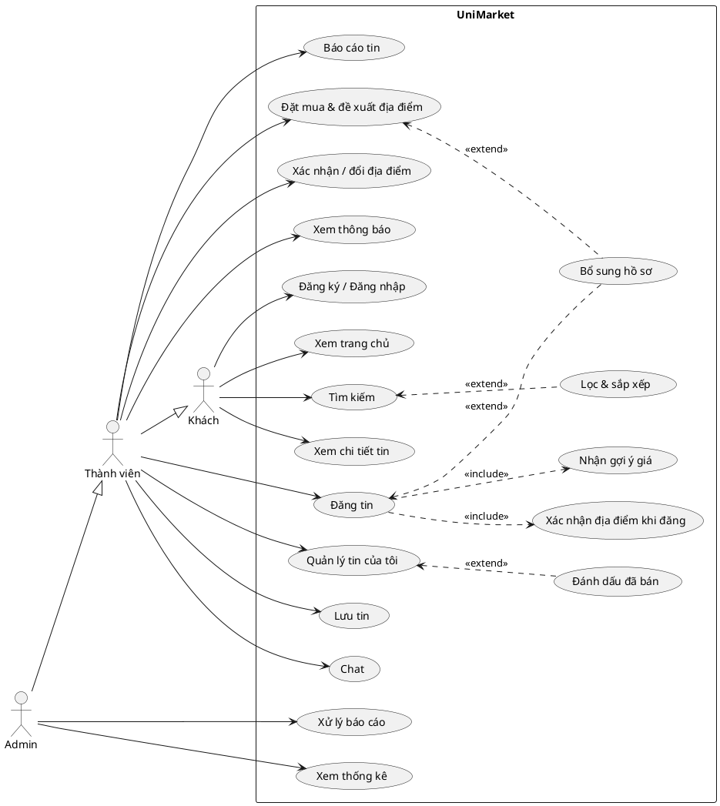
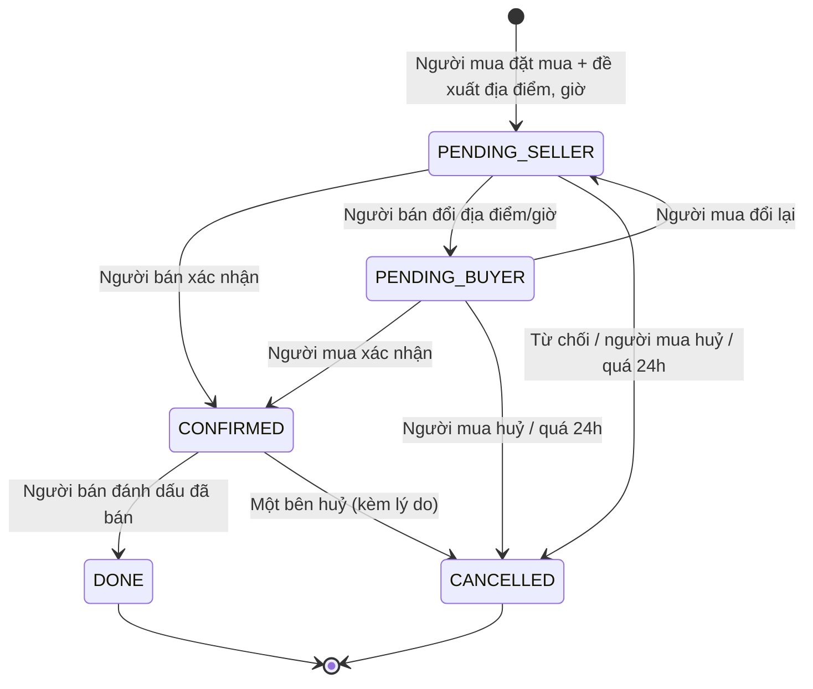

# 03 – Đặc tả yêu cầu

## 3.1. Tác nhân (Actor)

| Actor | Mô tả | Kế thừa |
|---|---|---|
| **Khách** | Chưa đăng nhập; chỉ xem/tìm tin, không thấy SĐT người bán | – |
| **Thành viên** | Đã đăng nhập. Xem được SĐT người bán. **Phải có hồ sơ đầy đủ** (BR-13) mới được đăng tin, đặt mua, chat, gọi/Zalo | Khách |
| **Người bán / Người mua** | Vai trò của thành viên trong một tin đăng hoặc một lịch hẹn cụ thể | Thành viên |
| **Quản trị viên (Admin)** | Xử lý vi phạm, quản lý danh mục và điểm giao dịch theo trường, xem thống kê | Thành viên |
| **Hệ thống** (tác nhân phụ) | Tự động hết hạn tin, tự ẩn tin bị báo cáo nhiều, gửi thông báo, nhắc lịch hẹn, tự huỷ yêu cầu mua quá hạn | – |

## 3.2. Danh sách use case

| Mã | Tên use case | Actor | Ưu tiên |
|---|---|---|---|
| **Tài khoản** ||||
| UC-01 | Đăng ký bằng email | Khách | M |
| UC-02 | Đăng nhập (email / Google) | Khách | M |
| UC-03 | Quên mật khẩu | Khách | M |
| UC-04 | Thiết lập & cập nhật hồ sơ (họ tên, SĐT, trường, thành phố, điểm giao dịch quen thuộc) | Thành viên | M |
| UC-05 | Bổ sung hồ sơ khi thiếu thông tin (chặn trước khi đăng tin / đặt mua / chat) | Thành viên | M |
| UC-06 | Đăng xuất | Thành viên | M |
| **Tin đăng** ||||
| UC-10 | Đăng tin bán | Thành viên | M |
| UC-11 | Nhận gợi ý giá | Thành viên | M (nâng cao) |
| UC-12 | Sửa tin | Thành viên (chủ tin) | M |
| UC-13 | Xoá tin | Thành viên (chủ tin) | M |
| UC-14 | Đánh dấu đã bán | Thành viên (chủ tin) | M |
| UC-15 | Gia hạn tin | Thành viên (chủ tin) | S |
| UC-16 | Xem "Tin của tôi" | Thành viên | M |
| UC-17 | Đẩy tin (mô phỏng thanh toán) | Thành viên (chủ tin) | C |
| UC-18 | Tạm ẩn / đánh dấu "Đang giao dịch" | Thành viên (chủ tin) | S |
| UC-19 | Xác nhận địa điểm giao dịch khi đăng tin | Thành viên (người bán) | M |
| **Tìm kiếm & xem** ||||
| UC-20 | Xem trang chủ | Khách | M |
| UC-21 | Tìm kiếm theo từ khoá | Khách | M |
| UC-22 | Lọc & sắp xếp kết quả | Khách | M |
| UC-23 | Duyệt theo danh mục | Khách | M |
| UC-24 | Xem chi tiết tin | Khách | M |
| UC-25 | Xem hồ sơ người bán | Khách | S |
| UC-26 | Lưu / bỏ lưu tin yêu thích | Thành viên | S |
| UC-27 | Đổi phạm vi xem (Trường / Thành phố / Toàn quốc) | Khách | M |
| **Liên hệ & tin cậy** ||||
| UC-30 | Liên hệ qua gọi điện / Zalo | Thành viên | M |
| UC-31 | Chat với người bán | Thành viên | S |
| UC-32 | Đánh giá người bán | Thành viên (người mua) | C |
| UC-33 | Chia sẻ tin ra ngoài (link) | Khách | C |
| UC-40 | Báo cáo tin vi phạm | Thành viên | S |
| **Đặt mua & lịch hẹn giao dịch** ||||
| UC-34 | Đặt mua và đề xuất địa điểm, giờ hẹn | Người mua | M |
| UC-35 | Xác nhận / đổi / từ chối địa điểm hẹn | Người bán (và người mua khi bị đổi) | M |
| UC-36 | Huỷ lịch hẹn | Người mua, Người bán | S |
| UC-37 | Xem thông báo | Thành viên | M |
| UC-38 | Xem "Lịch hẹn của tôi" | Thành viên | M |
| **Quản trị** ||||
| UC-50 | Quản lý điểm giao dịch theo trường | Admin | C |
| UC-51 | Xử lý tin bị báo cáo | Admin | M |
| UC-52 | Khoá / mở khoá tài khoản | Admin | S |
| UC-53 | Quản lý danh mục | Admin | C |
| UC-54 | Xem thống kê KPI | Admin | S |
| **Hệ thống** ||||
| UC-60 | Tự động hết hạn tin | Hệ thống | S |
| UC-61 | Tự động ẩn tin bị báo cáo nhiều | Hệ thống | S |
| UC-62 | Gửi thông báo và nhắc lịch hẹn trước 1 giờ | Hệ thống | M |
| UC-63 | Tự huỷ yêu cầu mua quá 24 giờ chưa được phản hồi | Hệ thống | S |

### Sơ đồ use case (PlantUML – dán vào plantuml.com hoặc plugin để xuất hình cho báo cáo)

## 3.3. Đặc tả use case chi tiết

### UC-02 – Đăng nhập
| Mục | Nội dung |
|---|---|
| Actor | Khách |
| Tiền điều kiện | Có Internet |
| Hậu điều kiện | Phiên đăng nhập được lưu; nếu hồ sơ chưa hoàn tất → chuyển SCR-05 |
| Luồng chính | 1. Khách mở SCR-03, nhập email + mật khẩu → 2. Bấm "Đăng nhập" → 3. Hệ thống xác thực qua Firebase Auth → 4. Kiểm tra `users/{uid}` đã có `schoolId` → 5. Vào trang chủ |
| Luồng thay thế | 1a. Chọn "Đăng nhập với Google" → chọn tài khoản → tiếp bước 4. 4a. Chưa có hồ sơ → SCR-05 thiết lập hồ sơ |
| Ngoại lệ | Sai mật khẩu → "Email hoặc mật khẩu không đúng". Tài khoản bị khoá (`isBanned`) → đăng xuất, báo "Tài khoản đã bị khoá, liên hệ…" |
| BR | BR-12 |

### UC-04 – Thiết lập hồ sơ
| Mục | Nội dung |
|---|---|
| Actor | Thành viên |
| Luồng chính | 1. Nhập họ tên → 2. Chọn trường từ danh sách có tìm kiếm (tự điền thành phố theo trường) → 3. Nhập SĐT (bắt buộc), Zalo (tuỳ chọn, mặc định = SĐT) → 4. Chọn **điểm giao dịch quen thuộc** từ danh sách điểm của trường (cổng chính, thư viện, căng tin…) hoặc tự nhập → 5. Chọn ảnh đại diện (tuỳ chọn) → 6. Lưu; hệ thống tính `profileComplete` |
| Luồng thay thế | 2a. Không thấy trường → chọn "Trường khác" và nhập tên; tin vẫn hiển thị theo thành phố. 6a. Bấm "Để sau" → vẫn vào app xem tin, nhưng `profileComplete = false` |
| Ngoại lệ | SĐT sai định dạng → báo lỗi tại trường |
| BR | BR-13, BR-17 |

### UC-05 – Bổ sung hồ sơ khi thiếu thông tin
| Mục | Nội dung |
|---|---|
| Actor | Thành viên |
| Kích hoạt | Thành viên có `profileComplete = false` bấm Đăng tin, Đặt mua, Chat, Gọi/Zalo hoặc Đẩy tin |
| Hậu điều kiện | Hồ sơ đầy đủ → tiếp tục đúng thao tác vừa bị chặn |
| Luồng chính | 1. Hệ thống mở bảng "Bổ sung thông tin để tiếp tục" (SCR-29), liệt kê các mục còn thiếu → 2. Bấm "Bổ sung ngay" → mở SCR-05 với các ô thiếu được đánh dấu → 3. Lưu → 4. Hệ thống quay lại thao tác ban đầu |
| Luồng thay thế | 1a. Bấm "Để sau" → đóng bảng, thao tác không được thực hiện |
| BR | BR-13 |

### UC-19 – Xác nhận địa điểm giao dịch khi đăng tin
| Mục | Nội dung |
|---|---|
| Actor | Người bán (trong UC-10) |
| Tiền điều kiện | Đã điền đủ bước 3 và xem trước tin |
| Hậu điều kiện | Tin có `meetingPlace` đã xác nhận (`placeConfirmedAt`); người bán nhận thông báo "Tin đã đăng" kèm địa điểm |
| Luồng chính | 1. Bấm "Đăng tin" ở SCR-15 → 2. Hệ thống mở bảng "Xác nhận địa điểm giao dịch" (SCR-30): trường, điểm hẹn, ghi chú, lưu ý an toàn → 3. Người bán tích "Tôi xác nhận có thể giao dịch tại địa điểm này" → 4. Bấm "Xác nhận & đăng tin" → 5. Tin được tạo; hệ thống gửi thông báo cho người bán |
| Luồng thay thế | 3a. Bấm "Đổi địa điểm" → quay về ô Nơi giao dịch ở SCR-14 |
| BR | BR-14, BR-34 |

### UC-10 – Đăng tin bán ⭐
| Mục | Nội dung |
|---|---|
| Actor | Thành viên |
| Tiền điều kiện | Đã đăng nhập, **hồ sơ đầy đủ** (BR-13; nếu thiếu → UC-05), không bị khoá, chưa vượt BR-04 |
| Hậu điều kiện | Tin được tạo với `status = ACTIVE`, `expiresAt = now + 30 ngày`, địa điểm giao dịch đã xác nhận, xuất hiện trong "Tin mới"; người bán nhận thông báo "Tin đã đăng" |
| Luồng chính | 1. Bấm nút ➕ → **Bước 1 (SCR-12):** chọn/chụp 1–6 ảnh, sắp xếp, chọn ảnh bìa → 2. **Bước 2 (SCR-13):** chọn danh mục cha → danh mục con → 3. **Bước 3 (SCR-14):** nhập tiêu đề, tình trạng, mô tả, các trường riêng theo danh mục (xem 3.7), giá gốc (tuỳ chọn), **nơi giao dịch** gồm trường + điểm hẹn + ghi chú (mặc định = điểm giao dịch quen thuộc trong hồ sơ), "Có thể ship" → 4. Hệ thống hiển thị **gợi ý giá** (include UC-11) → 5. Người dùng nhập giá hoặc bấm "Dùng giá này" → 6. **Xem trước (SCR-15)** → 7. Bấm "Đăng tin" → **xác nhận địa điểm giao dịch (include UC-19)** → 8. App nén & tải ảnh lên Storage, tạo tài liệu `listings`, sinh `keywords` → 9. Gửi thông báo "Tin đã đăng · Địa điểm giao dịch: …", chuyển tới "Tin của tôi" |
| Luồng thay thế | 1a. Người dùng thoát giữa chừng → hỏi "Lưu nháp?" → lưu `status = DRAFT` (C). 5a. Giá chênh > 50% so với gợi ý (độ tin cậy Trung bình trở lên) → hiện cảnh báo nhẹ "Giá của bạn cao/thấp hơn nhiều so với thị trường", vẫn cho đăng |
| Ngoại lệ | Mất mạng khi tải ảnh → giữ dữ liệu form, nút "Thử lại". Vượt 20 tin đang bán → chặn từ bước 1, gợi ý xoá/đánh dấu đã bán tin cũ. Nội dung chứa từ khoá cấm → chặn và báo lý do (BR-07) |
| BR | BR-01, BR-02, BR-03, BR-04, BR-07, BR-08, BR-13, BR-14 |

### UC-11 – Nhận gợi ý giá ⭐
| Mục | Nội dung |
|---|---|
| Actor | Thành viên (trong UC-10 hoặc UC-12) |
| Tiền điều kiện | Đã chọn danh mục con, đã nhập tiêu đề (≥ 10 ký tự) và tình trạng |
| Hậu điều kiện | Hiển thị thẻ gợi ý; lưu `suggestedPrice`, `suggestionConfidence` vào tin khi đăng |
| Luồng chính | 1. Người dùng nhập xong tiêu đề + tình trạng (hoặc đổi một trong hai) → 2. Sau 800 ms không gõ, hệ thống chạy thuật toán (04, mục 4.6) → 3. Hiển thị: giá đề xuất, khoảng giá, số mẫu, độ tin cậy → 4. Người dùng bấm "Dùng giá này" → điền vào ô giá |
| Luồng thay thế | 2a. Không đủ mẫu nhưng có giá gốc/giá bìa → hiển thị "Ước tính theo khấu hao". 2b. Không đủ mẫu và không có giá gốc → hiển thị "Chưa đủ dữ liệu – nhập giá gốc để nhận ước tính" |
| Ngoại lệ | Lỗi mạng → ẩn thẻ gợi ý, không chặn việc đăng tin |
| BR | BR-20 → BR-24 |

### UC-14 – Đánh dấu đã bán
| Mục | Nội dung |
|---|---|
| Actor | Chủ tin |
| Tiền điều kiện | Tin ở `ACTIVE` hoặc `RESERVED` |
| Hậu điều kiện | `status = SOLD`, có `soldPrice`, `soldAt`; tin biến mất khỏi kết quả tìm kiếm |
| Luồng chính | 1. Tại "Tin của tôi", chi tiết tin hoặc thẻ lịch hẹn đã xác nhận, bấm "Đã bán" → 2. Hộp thoại: nhập **giá bán thực tế** (mặc định = giá rao) → 3. Chọn người mua: mặc định là người mua trong lịch hẹn đã xác nhận; có thể chọn người khác trong các yêu cầu mua của tin (tuỳ chọn) → 4. Xác nhận |
| Luồng thay thế | 3a. Chọn "Người khác / không nhớ" → không phát sinh quyền đánh giá |
| Hậu quả nghiệp vụ | Lịch hẹn liên quan chuyển `DONE`, các yêu cầu mua khác của tin tự huỷ và người gửi nhận thông báo. Người mua được chọn nhận quyền đánh giá người bán (UC-32). `soldPrice` được dùng làm dữ liệu gợi ý giá (trọng số cao) |
| BR | BR-06, BR-21, BR-30 |

### UC-21/22 – Tìm kiếm, lọc, sắp xếp
| Mục | Nội dung |
|---|---|
| Actor | Khách |
| Luồng chính | 1. Bấm thanh tìm kiếm (SCR-07), nhập từ khoá → 2. Hệ thống chuẩn hoá từ khoá (bỏ dấu, chữ thường), truy vấn tin `ACTIVE` có chứa từ khoá theo phạm vi xem hiện tại → 3. Hiển thị lưới kết quả, phân trang 20 tin/lần → 4. Người dùng mở bộ lọc (SCR-08): danh mục, khoảng giá, tình trạng, có thể ship → 5. Chọn sắp xếp: Mới nhất (mặc định) / Giá tăng dần / Giá giảm dần → 6. Kết quả cập nhật |
| Luồng thay thế | 2a. Từ khoá rỗng nhưng có bộ lọc → liệt kê theo bộ lọc. 3a. Không có kết quả → trạng thái rỗng + nút "Mở rộng ra Toàn quốc" / "Xoá bộ lọc" |
| Ghi chú | Lưu 10 từ khoá gần nhất trên máy (C) |
| BR | BR-05, BR-09 |

### UC-31 – Chat với người bán
| Mục | Nội dung |
|---|---|
| Actor | Thành viên (người mua) |
| Tiền điều kiện | Đã đăng nhập, hồ sơ đầy đủ (nếu thiếu → UC-05), không phải chủ tin |
| Luồng chính | 1. Tại chi tiết tin, bấm "Chat" → 2. Hệ thống mở phòng chat có id `{listingId}_{buyerUid}` (tạo mới nếu chưa có) với thẻ thông tin tin đăng ở đầu → 3. Gửi tin nhắn văn bản; có các câu gợi ý nhanh: "Món này còn không bạn?", "Có thể bớt không?", "Hẹn gặp ở đâu?" → 4. Người bán thấy trong danh sách chat (SCR-21), có chấm đỏ chưa đọc |
| Ngoại lệ | Tin đã bán/bị xoá → phòng chat vẫn xem được nhưng hiện nhãn "Tin không còn bán" |
| BR | BR-31 |

### UC-34 – Đặt mua và đề xuất địa điểm ⭐
| Mục | Nội dung |
|---|---|
| Actor | Người mua |
| Tiền điều kiện | Đã đăng nhập, hồ sơ đầy đủ (nếu thiếu → UC-05), tin `ACTIVE` hoặc `RESERVED`, không phải chủ tin, chưa có yêu cầu đang hoạt động cho tin này (BR-33) |
| Hậu điều kiện | Tạo lịch hẹn `PENDING_SELLER`; người bán nhận thông báo "Có người muốn mua" kèm địa điểm và giờ |
| Luồng chính | 1. Tại chi tiết tin, bấm "Đặt mua" → 2. Bảng "Đặt mua & hẹn địa điểm" (SCR-31) mở ra, chọn sẵn **điểm giao dịch của tin** → 3. Người mua giữ nguyên hoặc chọn điểm khác trong danh sách điểm của trường / tự nhập → 4. Chọn giờ hẹn (gợi ý: hôm nay 17:00, mai 11:30, mai 17:00, hoặc tự chọn) → 5. Thêm lời nhắn (tuỳ chọn) → 6. Bấm "Gửi yêu cầu" → 7. Thông báo "Đã gửi, chờ người bán xác nhận địa điểm" |
| Luồng thay thế | 1a. Tin đang `RESERVED` → hiện cảnh báo "Đã có người hẹn trước, yêu cầu của bạn sẽ xếp hàng" (BR-36) |
| Ngoại lệ | Đã có 5 yêu cầu đang chờ → chặn, gợi ý huỷ bớt (BR-33). Giờ hẹn trong quá khứ hoặc quá 7 ngày → báo lỗi |
| BR | BR-13, BR-15, BR-33, BR-34, BR-36 |

### UC-35 – Xác nhận / đổi / từ chối địa điểm hẹn ⭐
| Mục | Nội dung |
|---|---|
| Actor | Người bán (với lịch hẹn `PENDING_SELLER`); người mua (với lịch hẹn `PENDING_BUYER`) |
| Kích hoạt | Nhận thông báo yêu cầu mua / đề xuất đổi, hoặc mở "Lịch hẹn của tôi" (SCR-25) |
| Luồng chính (xác nhận) | 1. Mở thông báo → thẻ lịch hẹn: người mua, món đồ, địa điểm, giờ, lời nhắn → 2. Bấm "Xác nhận địa điểm" → 3. Lịch hẹn `CONFIRMED`, tin chuyển `RESERVED` → 4. Hai bên nhận thông báo "Đã chốt hẹn: <địa điểm>, <giờ>"; hệ thống đặt nhắc trước 1 giờ |
| Luồng thay thế (đổi) | 2a. Bấm "Đổi địa điểm/giờ" → chọn lại (SCR-32) → gửi → lịch hẹn chuyển sang chờ bên kia (`PENDING_BUYER` hoặc ngược lại) → bên kia nhận thông báo và lặp lại UC-35 |
| Luồng thay thế (từ chối) | 2b. Bấm "Từ chối" → chọn lý do (đã bán, không tiện giờ, khác) → lịch hẹn `CANCELLED`, người mua nhận thông báo |
| BR | BR-35, BR-36, BR-37 |

### UC-36 – Huỷ lịch hẹn
| Mục | Nội dung |
|---|---|
| Actor | Người mua hoặc người bán trong lịch hẹn |
| Luồng chính | 1. Tại thẻ lịch hẹn bấm "Huỷ hẹn" → 2. Chọn lý do (bắt buộc với lịch đã xác nhận) → 3. Lịch hẹn `CANCELLED`, bên kia nhận thông báo → 4. Nếu tin không còn lịch hẹn `CONFIRMED` nào → tin trở về `ACTIVE` |
| BR | BR-38 |

### UC-37 – Xem thông báo
| Mục | Nội dung |
|---|---|
| Actor | Thành viên |
| Luồng chính | 1. Thông báo đến: hiện banner trên đầu màn hình (app đang mở) hoặc thông báo hệ thống Android (app đóng) và tăng số trên biểu tượng chuông → 2. Mở SCR-20: danh sách mới nhất trước, mục chưa đọc in đậm → 3. Bấm một thông báo → chuyển tới nội dung liên quan (lịch hẹn, tin đăng) và đánh dấu đã đọc |
| Loại thông báo | Tin đã đăng (kèm địa điểm) · Có yêu cầu mua · Đề xuất đổi địa điểm · Đã chốt hẹn · Nhắc hẹn trước 1 giờ · Lịch hẹn bị huỷ/từ chối · Tin sắp hết hạn · Mời đánh giá người bán |

### UC-40 – Báo cáo tin
| Mục | Nội dung |
|---|---|
| Actor | Thành viên |
| Luồng chính | 1. Tại chi tiết tin, bấm ⋮ → "Báo cáo" → 2. Chọn lý do: Lừa đảo / Hàng cấm / Sai danh mục / Thông tin sai sự thật / Spam / Khác (+ mô tả) → 3. Gửi → 4. Thông báo "Cảm ơn bạn" |
| Hậu điều kiện | Tạo `reports`; tăng `reportCount` của tin; nếu đạt BR-10 → tin chuyển `HIDDEN` (UC-61) |
| BR | BR-10, BR-11 |

### UC-51 – Xử lý tin bị báo cáo
| Mục | Nội dung |
|---|---|
| Actor | Admin |
| Luồng chính | 1. Mở SCR-26, danh sách báo cáo `PENDING` nhóm theo tin → 2. Xem chi tiết tin + các lý do → 3. Chọn: **Giữ tin** (báo cáo → `DISMISSED`, nếu tin đang `HIDDEN` → `ACTIVE`) / **Ẩn tin** (tin → `HIDDEN` vĩnh viễn, báo cáo → `RESOLVED`) / **Ẩn tin + khoá người bán** (UC-52) |
| BR | BR-11 |

### UC-54 – Xem thống kê
| Mục | Nội dung |
|---|---|
| Actor | Admin |
| Luồng chính | 1. Mở SCR-24 → 2. Chọn khoảng thời gian (7 ngày / 30 ngày / tất cả) → 3. Xem các thẻ KPI (KPI-01, 02, 04, 05, 06, 07, 11, 12) và biểu đồ số tin đăng / số tin bán theo ngày, phân bổ theo danh mục |
| Ghi chú | Dùng truy vấn tổng hợp `count()` của Firestore; số liệu này dùng trực tiếp cho chương đánh giá trong báo cáo |

## 3.4. User story (theo backlog)

| Mã | Là… | Tôi muốn… | Để… | UC | Ưu tiên |
|---|---|---|---|---|---|
| US-01 | sinh viên người bán | đăng tin trong dưới 2 phút | bán nhanh mà không mất công | UC-10 | M |
| US-02 | tân sinh viên | tìm giáo trình theo tên môn và trường | mua đúng sách | UC-21 | M |
| US-03 | người bán | biết món đồ đáng giá bao nhiêu | đặt giá hợp lý | UC-11 | M |
| US-04 | người bán | đánh dấu tin đã bán | không bị hỏi nữa | UC-14 | M |
| US-05 | người mua | lọc theo khoảng giá và tình trạng | không mất thời gian xem đồ quá đắt/quá cũ | UC-22 | M |
| US-06 | người mua | chỉ xem tin trong thành phố của mình | dễ gặp trực tiếp | UC-27 | M |
| US-07 | người mua | đặt mua kèm địa điểm và giờ hẹn, được người bán xác nhận | không đi gặp vô ích, gặp ở nơi an toàn | UC-34, UC-35 | M |
| US-08 | người mua | lưu các tin quan tâm | so sánh trước khi mua | UC-26 | S |
| US-09 | người mua | nhắn tin trong app | không phải lộ SĐT cá nhân | UC-31 | S |
| US-10 | người dùng | báo cáo tin lừa đảo | bảo vệ cộng đồng | UC-40 | S |
| US-11 | người bán | gia hạn tin hết hạn | không phải đăng lại | UC-15 | S |
| US-12 | người mua | đánh giá người bán sau khi mua | giúp người khác chọn người bán uy tín | UC-32 | C |
| US-13 | người bán | đẩy tin lên nổi bật | bán nhanh hơn | UC-17 | C |
| US-14 | admin | xem số liệu giao dịch | đánh giá hiệu quả của app | UC-54 | S |
| US-15 | người bán | nhận thông báo khi có người muốn mua, kèm địa điểm đề xuất | xác nhận hoặc đổi địa điểm chỉ bằng một chạm | UC-35, UC-37 | M |
| US-16 | người bán | xác nhận lại địa điểm giao dịch trước khi đăng tin | người mua thấy đúng nơi mình có thể đến | UC-19 | M |
| US-17 | người mua / người bán | được nhắc trước giờ hẹn | không quên, không bùng hẹn | UC-62 | M |
| US-18 | người dùng mới | xem tin ngay mà chưa phải điền hồ sơ, chỉ điền khi muốn mua/bán | thử app nhanh | UC-05 | M |

### Tiêu chí chấp nhận (Acceptance Criteria) cho các story chính

**US-01**
- Cho biết tôi đã đăng nhập và có hồ sơ đầy đủ, khi tôi hoàn thành 3 bước và bấm "Đăng tin", thì tin xuất hiện đầu mục "Tin mới" của thành phố tôi trong ≤ 5 giây (mạng 4G).
- Khi tôi bỏ trống trường bắt buộc, nút "Tiếp" bị vô hiệu và trường lỗi được đánh dấu đỏ kèm thông báo.

**US-03**
- Khi có ≥ 5 tin tương tự, thẻ gợi ý hiển thị giá đề xuất, khoảng giá, số mẫu và độ tin cậy.
- Khi tôi bấm "Dùng giá này", ô giá được điền giá đề xuất.
- Khi tôi đổi tình trạng từ "Tốt" sang "Cũ", giá gợi ý giảm tương ứng.

**US-04**
- Khi tôi đánh dấu "Đã bán" và nhập giá bán thực tế, tin chuyển sang tab "Đã bán" và không còn xuất hiện trong kết quả tìm kiếm.

**US-07 / US-15**
- Khi tôi gửi yêu cầu mua, người bán nhận thông báo trong ≤ 5 giây (app đang mở) với đúng địa điểm và giờ tôi chọn.
- Khi người bán xác nhận, tôi nhận thông báo "Đã chốt hẹn", lịch hẹn hiện ở mục "Đã xác nhận" và tin chuyển "Đang giao dịch".
- Khi người bán đổi địa điểm, lịch hẹn chưa được xác nhận cho tới khi tôi đồng ý địa điểm mới.

**US-16**
- Khi tôi bấm "Đăng tin" mà chưa tích ô xác nhận địa điểm, nút "Xác nhận & đăng tin" bị vô hiệu.

**US-18**
- Khi hồ sơ còn thiếu SĐT hoặc điểm giao dịch và tôi bấm "Đăng tin" / "Đặt mua", app hiện bảng liệt kê đúng các mục còn thiếu; bổ sung xong thì quay lại đúng thao tác đó.

## 3.5. Yêu cầu chức năng (FR)

| Mã | Mô tả | UC | Ưu tiên |
|---|---|---|---|
| FR-01 | Đăng ký bằng email + mật khẩu, gửi email xác minh | UC-01 | M |
| FR-02 | Đăng nhập email/mật khẩu và Google Sign-In | UC-02 | M |
| FR-03 | Gửi email đặt lại mật khẩu | UC-03 | M |
| FR-04 | Chọn trường từ danh sách có tìm kiếm; thành phố tự điền theo trường; chọn điểm giao dịch quen thuộc | UC-04 | M |
| FR-05 | Kiểm tra hồ sơ đầy đủ trước khi đăng tin / đặt mua / chat / gọi / đẩy tin; nếu thiếu thì hiện bảng liệt kê mục thiếu và quay lại thao tác sau khi bổ sung | UC-05 | M |
| FR-10 | Đăng tin theo 3 bước + xem trước | UC-10 | M |
| FR-11 | Nén ảnh ≤ 500 KB, cạnh dài ≤ 1280 px trước khi tải | UC-10 | M |
| FR-12 | Trường nhập riêng theo danh mục (xem 3.7) | UC-10 | S |
| FR-13 | Tự sinh `keywords` từ tiêu đề + trường riêng | UC-10 | M |
| FR-14 | Gợi ý giá với khoảng giá, số mẫu, độ tin cậy | UC-11 | M |
| FR-15 | Sửa, xoá (mềm) tin | UC-12, 13 | M |
| FR-16 | Đánh dấu đã bán, nhập giá bán thực tế, chọn người mua | UC-14 | M |
| FR-17 | Gia hạn tin hết hạn thêm 30 ngày | UC-15 | S |
| FR-18 | "Tin của tôi" với các tab: Đang bán, Đang giao dịch, Đã bán, Hết hạn, Bị ẩn | UC-16 | M |
| FR-19 | Đẩy tin mô phỏng: chọn gói, màn hình "thanh toán" giả lập, `boostedUntil = now + 3 ngày` | UC-17 | C |
| FR-20 | Trang chủ: tìm kiếm, lưới danh mục, "Nổi bật", "Tin mới", "Sách cho trường bạn" | UC-20 | M |
| FR-21 | Tìm kiếm không phân biệt dấu & hoa thường | UC-21 | M |
| FR-22 | Lọc theo danh mục, khoảng giá, tình trạng, có thể ship | UC-22 | M |
| FR-23 | Sắp xếp: mới nhất, giá tăng, giá giảm | UC-22 | M |
| FR-24 | Phân trang vô hạn 20 tin/lần | UC-21 | M |
| FR-25 | Chuyển phạm vi xem: Trường / Thành phố / Toàn quốc; ghi nhớ lựa chọn | UC-27 | M |
| FR-26 | Chi tiết tin: slide ảnh, giá, tình trạng, mô tả, trường riêng, người bán, lượt xem, tin tương tự | UC-24 | M |
| FR-27 | Lưu / bỏ lưu tin; danh sách "Đã lưu" | UC-26 | S |
| FR-28 | Hồ sơ người bán: thông tin, trường, điểm đánh giá, số giao dịch thành công, các tin đang bán | UC-25 | S |
| FR-30 | Nút Gọi điện (mở trình quay số) và Zalo (mở `zalo.me/{sđt}`), chỉ cho thành viên có hồ sơ đầy đủ | UC-30 | M |
| FR-31 | Chat văn bản thời gian thực, câu gợi ý nhanh, trạng thái đã đọc | UC-31 | S |
| FR-32 | Đánh giá 1–5 sao + nhận xét, chỉ khi được chọn là người mua | UC-32 | C |
| FR-33 | Chia sẻ tin qua Android Share Sheet | UC-33 | C |
| FR-34 | Đặt mua: chọn điểm hẹn (danh sách điểm của trường hoặc tự nhập), giờ hẹn, lời nhắn | UC-34 | M |
| FR-35 | Xác nhận / đổi / từ chối lịch hẹn; mọi thay đổi đều cần bên kia xác nhận lại | UC-35 | M |
| FR-36 | Huỷ lịch hẹn kèm lý do; tự trả tin về `ACTIVE` khi không còn hẹn đã xác nhận | UC-36 | S |
| FR-37 | Trung tâm thông báo: danh sách, đánh dấu đã đọc, số chưa đọc trên biểu tượng chuông, banner khi app đang mở | UC-37 | M |
| FR-38 | Thông báo đẩy Android khi app đóng; nhắc lịch hẹn trước 1 giờ | UC-62 | M (đẩy khi app đóng: S) |
| FR-39 | "Lịch hẹn của tôi": tab Chờ tôi xác nhận / Chờ bên kia / Đã xác nhận / Đã xong / Đã huỷ | UC-38 | M |
| FR-40 | Báo cáo tin với lý do | UC-40 | S |
| FR-41 | Bảng xác nhận địa điểm khi đăng tin, gửi thông báo "Tin đã đăng" kèm địa điểm | UC-19 | M |
| FR-50 | Thêm/sửa/ẩn điểm giao dịch của từng trường | UC-50 | C |
| FR-51 | Danh sách báo cáo, xử lý giữ/ẩn/khoá | UC-51 | M |
| FR-52 | Khoá/mở tài khoản | UC-52 | S |
| FR-53 | Thêm/sửa/ẩn danh mục | UC-53 | C |
| FR-54 | Dashboard KPI | UC-54 | S |
| FR-60 | Tin quá hạn không hiển thị và được chuyển `EXPIRED` | UC-60 | S |
| FR-61 | Tự ẩn tin khi đạt ngưỡng báo cáo | UC-61 | S |
| FR-63 | Tự huỷ yêu cầu mua quá 24 giờ chưa phản hồi, thông báo cho người mua | UC-63 | S |

## 3.6. Quy tắc nghiệp vụ (BR)

### Tin đăng
| Mã | Quy tắc |
|---|---|
| BR-01 | Tin có 1–6 ảnh; ảnh đầu tiên là ảnh bìa |
| BR-02 | Giá là số nguyên từ 0 đến 50.000.000đ. Giá 0 hiển thị "Tặng miễn phí" |
| BR-03 | Tin hết hạn sau **30 ngày** kể từ khi đăng/gia hạn; được gia hạn tối đa **2 lần** |
| BR-04 | Mỗi tài khoản tối đa **20 tin** ở trạng thái ACTIVE + RESERVED |
| BR-05 | Chỉ tin `ACTIVE` (và chưa quá `expiresAt`) mới xuất hiện trong tìm kiếm, trang chủ, danh mục |
| BR-06 | Tin `SOLD` không thể chuyển lại `ACTIVE`; muốn bán lại phải đăng tin mới |
| BR-07 | Chặn tin chứa từ khoá cấm (danh sách cấu hình: vũ khí, ma tuý, đề thi, tài liệu thi, hàng giả…) |
| BR-08 | Khi sửa tin, các trường thay đổi được: ảnh, tiêu đề, mô tả, giá, tình trạng, khu vực. Không đổi được danh mục cha |
| BR-09 | Xoá tin là **xoá mềm** (`status = DELETED`); dữ liệu giữ lại cho thống kê, không hiện với ai trừ admin |
| BR-10 | Tin bị **3 người khác nhau** báo cáo (báo cáo `PENDING`) → tự chuyển `HIDDEN` chờ admin |
| BR-11 | Một người chỉ báo cáo một tin một lần |

### Tài khoản
| Mã | Quy tắc |
|---|---|
| BR-12 | Tài khoản bị khoá không đăng nhập được; các tin `ACTIVE` của họ chuyển `HIDDEN` |
| BR-13 | **Hồ sơ đầy đủ** = có họ tên, SĐT, trường, thành phố, điểm giao dịch quen thuộc. Thiếu bất kỳ mục nào thì không được đăng tin, đặt mua, chat, gọi/Zalo, đẩy tin; vẫn được xem và tìm tin. Không có bước xác thực danh tính |
| BR-14 | Mỗi tin đăng phải được người bán **xác nhận địa điểm giao dịch** ngay trước khi đăng; sửa địa điểm của tin đang bán cũng phải xác nhận lại |
| BR-15 | Yêu cầu mua chờ phản hồi quá **24 giờ** thì tự huỷ, người mua nhận thông báo |
| BR-16 | Khách không thấy SĐT/Zalo của người bán |
| BR-17 | Điểm giao dịch quen thuộc trong hồ sơ là giá trị mặc định cho ô "Nơi giao dịch" khi đăng tin và khi đặt mua |

### Gợi ý giá (chi tiết thuật toán ở 04, mục 4.6)
| Mã | Quy tắc |
|---|---|
| BR-20 | Mẫu so sánh: cùng danh mục con, tương đồng tiêu đề ≥ 50%, trong 90 ngày, trạng thái ACTIVE hoặc SOLD |
| BR-21 | Tin SOLD dùng `soldPrice` và có trọng số **2**, tin ACTIVE dùng giá rao, trọng số **1** |
| BR-22 | Loại ngoại lai bằng quy tắc IQR (ngoài [Q1 − 1,5·IQR; Q3 + 1,5·IQR]) |
| BR-23 | Độ tin cậy: ≥ 10 mẫu **Cao**; 5–9 **Trung bình**; 3–4 **Thấp**; < 3 → chuyển sang ước tính khấu hao |
| BR-24 | Giá đề xuất làm tròn: < 100.000đ → bội số 1.000đ; 100.000đ–1.000.000đ → bội số 5.000đ; > 1.000.000đ → bội số 50.000đ |

### Giao dịch & tương tác
| Mã | Quy tắc |
|---|---|
| BR-30 | Chỉ người được chủ tin chọn khi "Đã bán" (mặc định là người mua trong lịch hẹn đã xác nhận) mới được đánh giá, mỗi tin một lần |
| BR-31 | Không tự chat hoặc tự đặt mua tin của mình |
| BR-32 | Chỉ thành viên có hồ sơ đầy đủ mới được đẩy tin; một tin không đẩy chồng khi đang trong thời gian đẩy |

### Đặt mua & lịch hẹn
| Mã | Quy tắc |
|---|---|
| BR-33 | Mỗi người mua chỉ có **1 yêu cầu đang hoạt động** cho một tin, và tối đa **5 yêu cầu đang chờ** cùng lúc |
| BR-34 | Địa điểm hẹn là một điểm trong danh sách điểm giao dịch của trường, hoặc mô tả tự nhập ≥ 10 ký tự. App luôn khuyến nghị nơi công cộng trong khuôn viên trường |
| BR-35 | Lịch hẹn chỉ `CONFIRMED` khi bên còn lại chấp nhận **đúng địa điểm và giờ mới nhất**. Mỗi lần đổi địa điểm/giờ đều gửi thông báo và chờ xác nhận lại |
| BR-36 | Khi một lịch hẹn được xác nhận, tin chuyển `RESERVED`; các yêu cầu khác của tin vẫn chờ (xếp hàng). Khi tin `SOLD`, các yêu cầu còn lại tự huỷ và người gửi nhận thông báo |
| BR-37 | Giờ hẹn phải sau thời điểm hiện tại ít nhất 30 phút và không quá 7 ngày. Hệ thống nhắc cả hai bên **trước 1 giờ** |
| BR-38 | Huỷ lịch hẹn đã xác nhận phải chọn lý do; tin trở về `ACTIVE` nếu không còn lịch hẹn `CONFIRMED` nào |
| BR-39 | Mọi sự kiện đăng tin, yêu cầu mua, đổi địa điểm, xác nhận, huỷ, nhắc hẹn đều tạo một thông báo cho đúng người liên quan |

## 3.7. Danh mục và thuộc tính riêng

| Danh mục cha | Danh mục con | Thuộc tính riêng (`attributes`) |
|---|---|---|
| 📚 **Sách** (`books`) | Giáo trình (`textbook`) | Tên môn học*, Mã môn, Tác giả, NXB, Năm XB, **Giá bìa** |
| | Sách tham khảo, ngoại ngữ (`reference`) | Tác giả, NXB, Giá bìa |
| | Truyện, tiểu thuyết (`novel`) | Tác giả, Giá bìa |
| 💻 **Đồ điện tử** (`electronics`) | Điện thoại, máy tính bảng (`phone`) | **Hãng***, **Model***, Dung lượng, Năm mua, Còn bảo hành |
| | Laptop (`laptop`) | **Hãng***, **Model***, CPU, RAM, Năm mua, Còn bảo hành |
| | Tai nghe, loa, phụ kiện (`accessory`) | Hãng, Năm mua |
| | Máy tính cầm tay (`calculator`) | Hãng, Model |
| 🏠 **Đồ dùng** (`household`) | Gia dụng (`appliance`) | Hãng, Năm mua |
| | Nội thất (`furniture`) | Chất liệu, Kích thước |
| | Quần áo, giày dép (`fashion`) | Size, Giới tính |
| | Xe đạp (`bicycle`) | Hãng, Loại xe |
| | Dụng cụ học tập, khác (`other`) | – |

(*) bắt buộc. Tất cả danh mục đều có trường chung "Giá mua gốc" (tuỳ chọn) để phục vụ ước tính khấu hao và KPI-09.

**Tình trạng (chuẩn hoá):**

| Mã | Hiển thị | Mô tả cho người dùng | Hệ số giá |
|---|---|---|---|
| `LIKE_NEW` | Như mới | Dùng rất ít, không trầy xước, còn đủ phụ kiện | 1,00 |
| `GOOD` | Tốt | Có dấu hiệu sử dụng nhẹ, hoạt động hoàn hảo | 0,85 |
| `FAIR` | Khá | Trầy xước/ghi chú rõ, vẫn dùng tốt | 0,70 |
| `USED` | Cũ | Hao mòn nhiều hoặc có lỗi nhỏ (ghi rõ trong mô tả) | 0,50 |

## 3.8. Vòng đời trạng thái

### Tin đăng

### Lịch hẹn giao dịch

Mỗi mũi tên đều phát sinh một thông báo cho bên còn lại (BR-39).

## 3.9. Quy tắc kiểm tra dữ liệu nhập (validation)

| Trường | Bắt buộc | Ràng buộc | Thông báo lỗi |
|---|---|---|---|
| Email | ✓ | Định dạng email | "Email không hợp lệ" |
| Mật khẩu | ✓ | ≥ 8 ký tự, có chữ và số | "Mật khẩu tối thiểu 8 ký tự gồm chữ và số" |
| Họ tên | ✓ | 2–50 ký tự | "Vui lòng nhập họ tên" |
| SĐT | ✓ | 10 số, bắt đầu bằng 0 | "Số điện thoại không hợp lệ" |
| Tiêu đề tin | ✓ | 10–80 ký tự | "Tiêu đề từ 10 đến 80 ký tự" |
| Mô tả | ✓ | 20–2.000 ký tự | "Mô tả tối thiểu 20 ký tự để người mua hiểu rõ hơn" |
| Giá | ✓ | 0–50.000.000, số nguyên | "Giá từ 0 đến 50 triệu" |
| Giá gốc / giá bìa | | ≥ giá rao (nếu nhập) | "Giá gốc thường cao hơn giá bán, bạn kiểm tra lại nhé" (cảnh báo, không chặn) |
| Ảnh | ✓ | 1–6 ảnh, JPG/PNG | "Cần ít nhất 1 ảnh" |
| Tình trạng | ✓ | 1 trong 4 giá trị | "Chọn tình trạng sản phẩm" |
| Năm mua | | 2000 – năm hiện tại | "Năm không hợp lệ" |
| Điểm giao dịch quen thuộc | ✓ (hồ sơ) | Chọn từ danh sách hoặc tự nhập ≥ 10 ký tự | "Chọn nơi bạn thường giao dịch, ví dụ: Cổng chính" |
| Điểm hẹn (đặt mua) | ✓ | Như trên | "Chọn địa điểm hẹn" |
| Giờ hẹn | ✓ | ≥ hiện tại + 30 phút, ≤ 7 ngày | "Giờ hẹn phải sau ít nhất 30 phút và trong vòng 7 ngày" |
| Lý do huỷ hẹn đã xác nhận | ✓ | Chọn 1 lý do | "Chọn lý do để bên kia biết" |

## 3.10. Yêu cầu phi chức năng (NFR)

| Mã | Nhóm | Yêu cầu | Cách đo |
|---|---|---|---|
| NFR-01 | Hiệu năng | Trang chủ hiển thị dữ liệu đầu tiên ≤ 2 giây trên 4G | Đo bằng Logcat/stopwatch, 10 lần lấy TB |
| NFR-02 | Hiệu năng | Gợi ý giá trả kết quả ≤ 1,5 giây | Đo trong app |
| NFR-03 | Hiệu năng | Cuộn danh sách mượt (không giật) với 200 tin | Kiểm tra thủ công / Profiler |
| NFR-04 | Dung lượng | Ảnh tải lên ≤ 500 KB/ảnh | Kiểm tra trên Firebase Storage |
| NFR-05 | Bảo mật | Chỉ chủ tin sửa/xoá tin; chỉ người mua và người bán của lịch hẹn mới đọc/sửa lịch hẹn đó; chỉ admin khoá tài khoản | Firestore Security Rules + test trên Emulator |
| NFR-06 | Hiệu năng | Thông báo đến người nhận ≤ 5 giây khi app đang mở; khi app đóng nhận được thông báo hệ thống (nếu bật đẩy qua FCM) | Đo trên 2 máy thật |
| NFR-07 | Riêng tư | Khách không thấy SĐT | Rules + UI |
| NFR-08 | Khả dụng | Người mới đăng được tin đầu tiên không cần hướng dẫn | Pilot: ≥ 80% tự đăng thành công |
| NFR-09 | Khả dụng | Điểm SUS ≥ 68 | Khảo sát sau pilot |
| NFR-10 | Tương thích | Android 8.0 (API 26) trở lên, màn hình 5"–6,9" | Chạy trên ≥ 2 thiết bị/emulator |
| NFR-11 | Tin cậy | Mất mạng không làm mất dữ liệu form đang nhập | Kiểm thử thủ công |
| NFR-12 | Ngôn ngữ | Giao diện tiếng Việt, định dạng tiền `1.250.000đ`, ngày `dd/MM/yyyy` | Kiểm thử thủ công |
| NFR-13 | Trợ năng | Vùng chạm ≥ 48dp, có `contentDescription` cho ảnh/icon | Accessibility Scanner |
| NFR-14 | Bảo trì | Mã nguồn theo MVVM, tách tầng data/domain/ui; logic gợi ý giá có unit test | Review mã |
