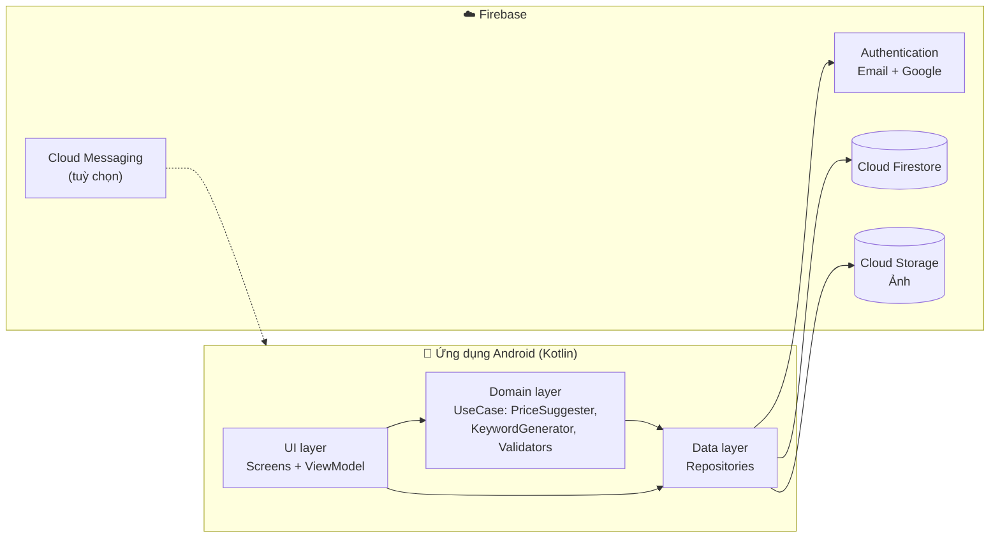
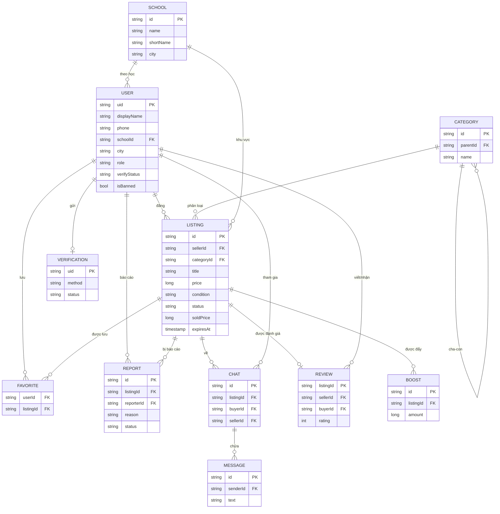
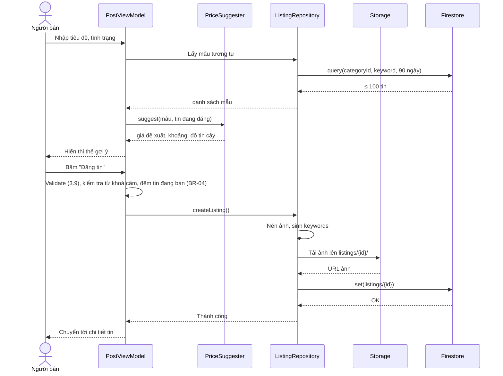

# 04 – Thiết kế hệ thống

## 4.1. Kiến trúc tổng thể



- **Không có server riêng.** Mọi nghiệp vụ chạy trên app; tính đúng đắn & quyền hạn được bảo đảm bằng **Firestore/Storage Security Rules**.
- **MVVM + Repository**: View (Activity/Fragment hoặc Composable) chỉ hiển thị trạng thái do ViewModel cung cấp; ViewModel gọi UseCase/Repository; Repository là nơi duy nhất nói chuyện với Firebase.
- **Luồng dữ liệu một chiều**: ViewModel phát `UiState` (Loading / Success / Empty / Error) qua `StateFlow`.

## 4.2. Công nghệ

| Thành phần | Lựa chọn | Ghi chú |
|---|---|---|
| Ngôn ngữ | Kotlin | |
| UI | **Jetpack Compose + Material 3** (đề xuất) — phương án thay thế: XML + ViewBinding | Chọn theo yêu cầu môn học; tài liệu giao diện áp dụng được cho cả hai |
| Điều hướng | Navigation Compose (hoặc Navigation Component) | |
| Bất đồng bộ | Kotlin Coroutines + Flow | |
| DI | Hilt | Có thể bỏ, dùng khởi tạo thủ công nếu muốn đơn giản |
| Ảnh | Coil (tải ảnh), thư viện nén ảnh (vd. Compressor) hoặc tự nén bằng `Bitmap.compress` | |
| Backend | Firebase BoM: Auth, Firestore, Storage, (Messaging) | |
| Lưu cục bộ | DataStore (lưu phạm vi xem, lịch sử tìm kiếm) | Firestore đã có cache offline |
| Biểu đồ (Admin) | Vico hoặc MPAndroidChart | |
| Kiểm thử | JUnit (logic), Firebase Emulator Suite (Rules), kiểm thử thủ công theo TC | |
| Quản lý mã | Git + GitHub | Commit theo mã UC/FR |

### Quyết định kiến trúc (ADR)

| Mã | Quyết định | Phương án đã cân nhắc | Lý do chọn |
|---|---|---|---|
| ADR-1 | Firebase thay vì tự viết API (Node/Spring) + MySQL | Tự viết backend | 1 người, giảm 40–50% khối lượng; có realtime cho chat |
| ADR-2 | Tìm kiếm bằng mảng `keywords` | Algolia/Typesense | Miễn phí, không cần server; chấp nhận hạn chế (mục 4.5) |
| ADR-3 | Gợi ý giá tính trên thiết bị | Cloud Functions | Không cần gói trả phí; dữ liệu ≤ 100 mẫu nên đủ nhanh |
| ADR-4 | Phi chuẩn hoá thông tin người bán vào tin đăng | Join khi đọc | Firestore không có join; giảm số lần đọc khi hiển thị danh sách |
| ADR-5 | Xoá mềm tin đăng | Xoá cứng | Giữ dữ liệu cho gợi ý giá & KPI |
| ADR-6 | Tham số nghiệp vụ (hệ số, từ khoá cấm) để trong `config/app` | Hard-code | Điều chỉnh không cần cập nhật app |

> ⚠️ **Lưu ý Firebase:** theo thông tin tại thời điểm viết, dự án Firebase mới cần gói **Blaze** (gắn thẻ, vẫn có hạn mức miễn phí) để dùng Cloud Storage. Kiểm tra lại chính sách hiện hành; đặt **cảnh báo ngân sách** (vd. 1 USD). Phương án thay thế lưu ảnh: Cloudinary (gói miễn phí).

## 4.3. Cấu trúc mã nguồn (gợi ý)

```
app/src/main/java/com/unimarket/
├─ UniMarketApp.kt
├─ core/
│  ├─ model/            # Data class: User, Listing, School, Category, Chat, Message, Report, Review…
│  ├─ util/             # TextNormalizer, MoneyFormatter, DateFormatter, ImageCompressor
│  └─ ui/               # Theme, component dùng chung: ListingCard, ConditionBadge, PriceText, EmptyState
├─ data/
│  ├─ repository/       # AuthRepository, UserRepository, ListingRepository, ChatRepository,
│  │                    # ReportRepository, AdminRepository, ConfigRepository
│  └─ remote/           # Wrapper Firestore/Storage, mapper document ↔ model
├─ domain/
│  ├─ KeywordGenerator.kt     # 4.5
│  ├─ PriceSuggester.kt       # 4.6  (thuần Kotlin → dễ unit test)
│  └─ ListingValidator.kt     # 3.9
└─ feature/
   ├─ auth/        # SCR-03, 04
   ├─ onboarding/  # SCR-01, 02, 05
   ├─ home/        # SCR-06
   ├─ search/      # SCR-07, 08
   ├─ category/    # SCR-09
   ├─ listing/     # SCR-10, 11 (chi tiết, hồ sơ người bán)
   ├─ post/        # SCR-12 → 15 (đăng/sửa tin)
   ├─ mylistings/  # SCR-16
   ├─ favorites/   # SCR-17
   ├─ account/     # SCR-18, 19, 20
   ├─ chat/        # SCR-21, 22
   └─ admin/       # SCR-24, 25, 26
```

## 4.4. Thiết kế dữ liệu

### 4.4.1. Mô hình khái niệm (ERD)



> Sơ đồ ERD này dùng cho báo cáo (mức khái niệm). Firestore là CSDL NoSQL dạng tài liệu nên khi cài đặt có **phi chuẩn hoá** (mục 4.4.2).

### 4.4.2. Cấu trúc Firestore

```
schools/{schoolId}
categories/{categoryId}
config/app
users/{uid}
users/{uid}/favorites/{listingId}
listings/{listingId}
reports/{listingId}_{reporterUid}
verifications/{uid}
reviews/{listingId}
chats/{listingId}_{buyerUid}
chats/{chatId}/messages/{messageId}
boosts/{boostId}
```

#### `users/{uid}`
| Trường | Kiểu | Ghi chú |
|---|---|---|
| displayName | string | |
| avatarUrl | string? | |
| phone | string | Chỉ thành viên đăng nhập đọc được (BR-16) |
| zalo | string? | Mặc định = phone |
| schoolId, schoolName | string | `schoolName` phi chuẩn hoá để hiển thị |
| city | string | Theo danh mục tỉnh/thành hiện hành (34 đơn vị từ 07/2025) |
| role | string | `user` \| `admin` (admin đặt thủ công trên Console) |
| verifyStatus | string | `NONE` \| `PENDING` \| `VERIFIED` \| `REJECTED` |
| isBanned | bool | |
| createdAt, lastActiveAt | timestamp | `lastActiveAt` cập nhật tối đa 1 lần/ngày → KPI-04 |

> Không lưu email trong Firestore (đã có trong Firebase Auth) để tránh lộ thông tin.

#### `schools/{schoolId}`
`name`, `shortName` (vd. "NEU"), `city`, `emailDomains: string[]` (vd. `["st.neu.edu.vn"]`), `active: bool`. Nhập sẵn từ file JSON khi khởi tạo.

#### `categories/{categoryId}`
`name`, `parentId` (null nếu là danh mục cha), `icon`, `order`, `active`, `attributes: [{key, label, type, required}]` (định nghĩa trường riêng ở 3.7), `depreciationRate` (dùng cho 4.6).

#### `listings/{listingId}` ⭐
| Trường | Kiểu | Ghi chú |
|---|---|---|
| sellerId | string | |
| sellerName, sellerAvatarUrl, sellerVerified | string/bool | Phi chuẩn hoá (ADR-4); cập nhật hàng loạt khi người dùng đổi hồ sơ |
| schoolId, schoolName, city | string | Khu vực giao dịch |
| parentCategoryId, categoryId | string | |
| title, description | string | |
| price | number (long) | Giá rao, đơn vị đồng |
| originalPrice | number? | Giá mua gốc / giá bìa |
| condition | string | `LIKE_NEW` \| `GOOD` \| `FAIR` \| `USED` |
| attributes | map | Trường riêng theo danh mục |
| images | string[] | URL ảnh, phần tử 0 = ảnh bìa |
| keywords | string[] | Sinh bởi KeywordGenerator (4.5) |
| shippable | bool | |
| meetingPlace | string? | "Cổng chính ĐH Kinh tế Quốc dân" |
| status | string | `DRAFT` \| `ACTIVE` \| `RESERVED` \| `SOLD` \| `EXPIRED` \| `HIDDEN` \| `DELETED` |
| suggestedPrice, suggestionLow, suggestionHigh | number? | Kết quả gợi ý tại thời điểm đăng → KPI-07, KPI-08 |
| suggestionConfidence | string? | `HIGH` \| `MEDIUM` \| `LOW` \| `ESTIMATE` |
| suggestionSampleSize | number? | |
| soldPrice, soldAt, soldToUid | number?/timestamp?/string? | |
| viewCount, favoriteCount, reportCount | number | Tăng bằng `FieldValue.increment(1)` |
| renewCount | number | ≤ 2 (BR-03) |
| boostedUntil | timestamp? | |
| createdAt, updatedAt, expiresAt | timestamp | `expiresAt = createdAt + 30 ngày` |

#### `users/{uid}/favorites/{listingId}`
`createdAt` + bản chụp `title`, `price`, `coverUrl`, `status` để hiển thị nhanh.

#### `reports/{listingId}_{reporterUid}`
`listingId`, `reporterId`, `reason` (`SCAM` \| `PROHIBITED` \| `WRONG_CATEGORY` \| `FALSE_INFO` \| `SPAM` \| `OTHER`), `note`, `status` (`PENDING` \| `RESOLVED` \| `DISMISSED`), `createdAt`, `handledBy`, `handledAt`.
→ ID ghép giúp **mỗi người chỉ báo cáo một tin một lần** (BR-11) mà không cần truy vấn kiểm tra.

#### `verifications/{uid}`
`method` (`CARD` \| `EMAIL`), `studentId`, `cardImagePath`, `schoolEmail`, `status`, `rejectReason`, `createdAt`, `reviewedBy`, `reviewedAt`.

#### `reviews/{listingId}`
`sellerId`, `buyerId`, `rating` (1–5), `comment`, `createdAt`. ID = listingId → mỗi giao dịch một đánh giá (BR-30). Điểm trung bình người bán tính khi đọc (truy vấn `reviews where sellerId == X`).

#### `chats/{listingId}_{buyerUid}`
`listingId`, `listingTitle`, `listingCoverUrl`, `sellerId`, `buyerId`, `participants: [buyerId, sellerId]`, `lastMessage`, `lastSenderId`, `updatedAt`, `unread: { uid: number }`.
`messages/{id}`: `senderId`, `text`, `createdAt`.

#### `boosts/{boostId}` (giao dịch mô phỏng)
`listingId`, `userId`, `package` (`BOOST_3D`), `amount` (10000), `createdAt` → KPI-12.

#### `config/app`
```json
{
  "listingTtlDays": 30,
  "maxRenew": 2,
  "maxActiveListings": 20,
  "reportHideThreshold": 3,
  "bannedKeywords": ["ma tuy", "vu khi", "de thi", "dap an thi", "hang gia"],
  "conditionFactor": { "LIKE_NEW": 1.0, "GOOD": 0.85, "FAIR": 0.70, "USED": 0.50 },
  "bookRatio": { "LIKE_NEW": 0.60, "GOOD": 0.50, "FAIR": 0.40, "USED": 0.30 },
  "priceWindowDays": 90,
  "minYearsResidual": 0.20
}
```

### 4.4.3. Chỉ mục (composite index) cần tạo

| Truy vấn | Trường chỉ mục |
|---|---|
| Tin mới theo thành phố | `status ==`, `city ==`, `createdAt desc` |
| Tin mới theo trường | `status ==`, `schoolId ==`, `createdAt desc` |
| Theo danh mục + thành phố | `status ==`, `categoryId ==`, `city ==`, `createdAt desc` (và bản `parentCategoryId`) |
| Sắp xếp theo giá | `status ==`, `city ==`, `price asc/desc` |
| Tìm kiếm từ khoá | `keywords array-contains`, `status ==`, `city ==`, `createdAt desc` |
| Mẫu cho gợi ý giá | `categoryId ==`, `keywords array-contains`, `createdAt desc` |
| Tin nổi bật | `status ==`, `city ==`, `boostedUntil desc` |
| Tin của tôi | `sellerId ==`, `status ==`, `createdAt desc` |
| Chat của tôi | `participants array-contains`, `updatedAt desc` |

> Mẹo: khi chạy một truy vấn thiếu chỉ mục, Logcat in ra **đường link tạo chỉ mục** — bấm vào là tạo được.

### 4.4.4. Phân chia lọc trên server và trên máy

Để tránh bùng nổ số chỉ mục, quy ước:

| Điều kiện | Thực hiện ở |
|---|---|
| `status`, phạm vi (`city`/`schoolId`), danh mục, sắp xếp, từ khoá chính | **Firestore** |
| Khoảng giá (khi sắp xếp theo giá) | **Firestore** |
| Khoảng giá (khi sắp xếp mới nhất), tình trạng, đã xác thực, có thể ship, `expiresAt > now`, các từ khoá phụ | **Trên máy**, sau khi tải trang |

Hệ quả: một trang có thể ít hơn 20 tin sau khi lọc → app tự tải thêm trang cho tới khi đủ hoặc hết dữ liệu.

## 4.5. Thiết kế tìm kiếm (KeywordGenerator)

Firestore không hỗ trợ tìm kiếm toàn văn, nên mỗi tin lưu sẵn mảng `keywords`.

### Bước sinh từ khoá khi đăng/sửa tin
1. **Gộp văn bản:** `title` + các thuộc tính quan trọng (`brand`, `model`, `subjectName`, `subjectCode`, `author`).
2. **Chuẩn hoá:** chữ thường → bỏ dấu tiếng Việt (`đ → d`) → thay ký tự không phải chữ/số bằng khoảng trắng.
3. **Tách từ** theo khoảng trắng, bỏ từ < 2 ký tự.
4. **Bỏ từ dừng** (stopword): `ban, can, thanh, ly, pass, gia, re, moi, cu, con, dung, minh, nhu, va, cho, cua, the, la, o, tai, nhe, ib, inbox, lien, he`…
5. **Thêm cặp từ liền kề (bigram)** nối bằng `_`: "kinh te vi mo" → `kinh_te`, `te_vi`, `vi_mo`.
6. **Thêm từ ghép model** (đồ điện tử): `brand + model` bỏ khoảng trắng → `iphone11`, `casiofx580vnx`.
7. Loại trùng, giới hạn 40 phần tử.

**Ví dụ:** "Thanh lý giáo trình Kinh tế vi mô – NEU" →
`[giao, trinh, kinh, te, vi, mo, neu, giao_trinh, trinh_kinh, kinh_te, te_vi, vi_mo, mo_neu]`

### Bước tìm kiếm
1. Chuẩn hoá chuỗi người dùng nhập giống hệt bước 2–4.
2. Chọn **từ neo**: nếu có ≥ 2 từ → bigram dài nhất; nếu 1 từ → chính từ đó.
3. Firestore: `keywords array-contains <từ neo>` + điều kiện phạm vi/trạng thái + sắp xếp.
4. Trên máy: giữ tin chứa **tất cả** từ đơn của truy vấn.

**Hạn chế (nêu trong báo cáo):** không tìm theo tiền tố ("iph" không ra "iphone"), không sửa lỗi chính tả. Hướng phát triển: dùng Algolia/Typesense qua Firebase Extension.

## 4.6. Thuật toán gợi ý giá (PriceSuggester) ⭐

### 4.6.1. Đầu vào – đầu ra

| Đầu vào | Đầu ra |
|---|---|
| `categoryId`, `title`, `attributes`, `condition` (đích), `city`, `originalPrice?`, `purchaseYear?` | `suggested`, `low`, `high`, `sampleSize`, `confidence` (`HIGH`/`MEDIUM`/`LOW`/`ESTIMATE`/`NONE`), `scope` (`CITY`/`NATIONAL`/`DEPRECIATION`) |

### 4.6.2. Các bước

```
Bước 1 – Lấy mẫu
  T = tập từ đơn của tin đang đăng (theo 4.5, bỏ bigram)
  Từ neo = từ ghép model (nếu là đồ điện tử) hoặc từ dài nhất trong T
  Truy vấn: categoryId == X, keywords array-contains từ neo,
            createdAt ≥ hôm nay − 90 ngày, sắp xếp mới nhất, tối đa 100 tin
  Giữ lại tin có status ∈ {ACTIVE, SOLD}
  Giữ lại tin có độ tương đồng |T ∩ S| / |T| ≥ 0,5   (S = từ đơn của tin mẫu)

Bước 2 – Chuẩn hoá về "Như mới"
  Với mỗi mẫu i: giá_i = soldPrice nếu SOLD, ngược lại price
                 trọng_số_i = 2 nếu SOLD, 1 nếu ACTIVE
                 g_i = giá_i / hệ_số_tình_trạng(mẫu i)

Bước 3 – Chọn phạm vi
  Nếu số mẫu cùng city ≥ 5  → dùng mẫu cùng city      (scope = CITY)
  Ngược lại nếu tổng mẫu ≥ 3 → dùng toàn bộ mẫu         (scope = NATIONAL)
  Ngược lại → Bước 6 (ước tính khấu hao)

Bước 4 – Loại ngoại lai (IQR)
  Q1, Q3 = tứ phân vị của {g_i};  IQR = Q3 − Q1
  Loại g_i ngoài [Q1 − 1,5·IQR ; Q3 + 1,5·IQR]
  Nếu sau khi loại còn < 3 mẫu → Bước 6

Bước 5 – Tính kết quả
  G      = trung vị có trọng số của {g_i}
  f      = hệ_số_tình_trạng(condition đích)
  suggested = làm_tròn(G × f)
  low    = làm_tròn(P25{g_i} × f);   high = làm_tròn(P75{g_i} × f)
  confidence theo số mẫu còn lại: ≥10 HIGH, 5–9 MEDIUM, 3–4 LOW

Bước 6 – Ước tính khấu hao (khi thiếu dữ liệu)
  Nếu là Sách và có giá bìa B:
      suggested = B × tỷ_lệ_sách(condition)          (60/50/40/30%)
      low/high  = B × (tỷ_lệ − 10%) / B × (tỷ_lệ + 10%)
  Nếu là danh mục khác và có giá gốc P:
      n = năm hiện tại − năm mua (nếu = 0 thì n = 0,5; không có năm mua thì n = 1)
      còn_lại = max(1 − r × n, 20%)                    (r = depreciationRate của danh mục)
      suggested = P × còn_lại × f;  low/high = suggested × 0,85 / × 1,15
  confidence = ESTIMATE, scope = DEPRECIATION
  Nếu không có giá gốc/giá bìa → confidence = NONE ("Chưa đủ dữ liệu")
```

### 4.6.3. Tham số

**Hệ số tình trạng** (`f`): Như mới 1,00 · Tốt 0,85 · Khá 0,70 · Cũ 0,50.

**Tỷ lệ khấu hao năm** (`r`) theo danh mục con:

| Danh mục | r | | Danh mục | r |
|---|---|---|---|---|
| Điện thoại, tablet | 25% | | Gia dụng | 15% |
| Laptop | 20% | | Nội thất | 10% |
| Phụ kiện | 30% | | Quần áo, giày | 30% |
| Máy tính cầm tay | 10% | | Xe đạp | 15% |
| Khác | 20% | | | |

Các tham số là **giả định ban đầu**; sau pilot, dùng KPI-08 (MAPE) để hiệu chỉnh — đây là nội dung tốt cho phần đánh giá.

**Quy tắc làm tròn** (BR-24): < 100.000đ → bội 1.000đ · 100.000–1.000.000đ → bội 5.000đ · > 1.000.000đ → bội 50.000đ.

### 4.6.4. Ví dụ tính toán (đưa vào báo cáo)

Tin đang đăng: *"Giáo trình Kinh tế vi mô"*, tình trạng **Tốt** (f = 0,85), Hà Nội. Tìm được 7 mẫu cùng thành phố:

| # | Giá | Tình trạng (hệ số) | Trạng thái (trọng số) | g = giá / hệ số |
|---|---|---|---|---|
| 1 | 40.000 | Tốt (0,85) | SOLD (2) | 47.059 |
| 2 | 50.000 | Như mới (1,00) | ACTIVE (1) | 50.000 |
| 3 | 35.000 | Khá (0,70) | SOLD (2) | 50.000 |
| 4 | 45.000 | Tốt (0,85) | ACTIVE (1) | 52.941 |
| 5 | 30.000 | Cũ (0,50) | SOLD (2) | 60.000 |
| 6 | 55.000 | Như mới (1,00) | SOLD (2) | 55.000 |
| 7 | 150.000 | Tốt (0,85) | ACTIVE (1) | 176.471 |

1. Sắp xếp g: 47.059 · 50.000 · 50.000 · 52.941 · 55.000 · 60.000 · 176.471
2. Q1 = 50.000, Q3 = 60.000, IQR = 10.000 → khoảng chấp nhận [35.000; 75.000] → **loại mẫu #7** (ngoại lai).
3. Còn 6 mẫu, tổng trọng số = 10. Cộng dồn theo thứ tự: 47.059 (2) → 50.000[#2] (3) → 50.000[#3] (5) → đạt một nửa tổng trọng số ⇒ **trung vị có trọng số G = 50.000**.
4. suggested = 50.000 × 0,85 = 42.500 → làm tròn **43.000đ**.
5. P25 = 50.000, P75 = 55.000 → khoảng **43.000đ – 47.000đ**.
6. 6 mẫu → độ tin cậy **Trung bình**.

**Ví dụ ước tính khấu hao:** Laptop giá gốc 15.000.000đ, mua năm 2024, tình trạng Tốt, năm hiện tại 2026 → n = 2, r = 20% → còn lại 60% → 15.000.000 × 0,6 × 0,85 = **7.650.000đ**, khoảng 6.500.000đ – 8.800.000đ, nhãn "Ước tính".

### 4.6.5. Đánh giá thuật toán
- **MAPE** (KPI-08) trên các tin đã bán có `suggestedPrice`: `TB(|soldPrice − suggestedPrice| / soldPrice)`. Mục tiêu < 25%.
- **Tỷ lệ chấp nhận** (KPI-07).
- So sánh MAPE giữa nhóm có độ tin cậy Cao/Trung bình/Thấp/Ước tính → kiểm chứng rằng nhiều dữ liệu hơn thì gợi ý chính xác hơn.

## 4.7. Các luồng xử lý quan trọng

### Đăng tin


### Các nghiệp vụ "tự động" khi không có server

| Nghiệp vụ | Cách làm |
|---|---|
| Hết hạn tin (UC-60) | Truy vấn công khai lọc `expiresAt > now` trên máy nên tin quá hạn không hiển thị. Khi chủ tin mở "Tin của tôi", app chuyển các tin quá hạn sang `EXPIRED`. (Nếu dùng gói Blaze: có thể thay bằng Cloud Function chạy hằng ngày.) |
| Tự ẩn khi bị báo cáo (UC-61) | Người báo cáo chạy **transaction**: tạo `reports/{listingId}_{uid}`, tăng `reportCount`; nếu `reportCount` mới ≥ 3 thì đặt `status = HIDDEN`. Rules chỉ cho phép thay đổi đúng hai trường này theo đúng điều kiện. |
| Đếm lượt xem | `viewCount += 1` khi mở chi tiết (không tính chủ tin, tối đa 1 lần/phiên). |
| Đồng bộ thông tin người bán | Khi đổi tên/ảnh/xác thực → batch update các tin của người đó. |
| Khoá tài khoản (UC-52) | Admin đặt `isBanned = true` và batch chuyển tin ACTIVE của người đó sang `HIDDEN`. |

## 4.8. Bảo mật – Security Rules (đặc tả)

Rules sẽ được viết trong giai đoạn code và **kiểm thử bằng Firebase Emulator** (06, mục 6.3).

| Collection | Đọc | Tạo | Cập nhật | Xoá |
|---|---|---|---|---|
| `schools`, `categories`, `config` | Mọi người | Admin | Admin | Admin |
| `users/{uid}` | Người đã đăng nhập | Chính chủ, `role = user`, `verifyStatus = NONE`, `isBanned = false` | Chính chủ (không được sửa `role`, `verifyStatus`, `isBanned`); Admin (mọi trường) | Không |
| `users/{uid}/favorites` | Chính chủ | Chính chủ | Chính chủ | Chính chủ |
| `listings` | Tin `ACTIVE`/`RESERVED`/`SOLD`: mọi người; trạng thái khác: chủ tin & admin | Đã đăng nhập, không bị khoá, `sellerId == uid`, `status ∈ {DRAFT, ACTIVE}`, dữ liệu hợp lệ (độ dài, giá, số ảnh) | Chủ tin (không đổi `sellerId`, `createdAt`, `reportCount`; chuyển trạng thái theo sơ đồ 3.8); Người khác: chỉ `viewCount`/`favoriteCount` ±1, hoặc `reportCount + 1` (và `status → HIDDEN` khi ≥ 3); Admin | Không (xoá mềm) |
| `reports` | Admin | Đã đăng nhập, ID = `{listingId}_{uid}`, không phải chủ tin | Admin | Không |
| `verifications/{uid}` | Chính chủ, Admin | Chính chủ, `status = PENDING` | Admin | Không |
| `reviews/{listingId}` | Mọi người | `buyerId == uid` và `listings/{listingId}.soldToUid == uid` | Không | Không |
| `chats/{id}` + `messages` | Thành viên trong `participants` | Người mua (`buyerId == uid`), không phải người bán | Thành viên trong `participants` | Không |
| `boosts` | Chính chủ, Admin | Chính chủ đã xác thực | Không | Không |

**Storage:**

| Đường dẫn | Đọc | Ghi |
|---|---|---|
| `listings/{listingId}/{file}` | Mọi người | Đã đăng nhập; ảnh `image/*`, ≤ 1 MB |
| `avatars/{uid}.jpg` | Mọi người | Chính chủ; ≤ 1 MB |
| `verifications/{uid}/card.jpg` | Chính chủ, Admin | Chính chủ; ≤ 2 MB |

Hàm tiện ích trong Rules: `isSignedIn()`, `isOwner(uid)`, `isAdmin()` (đọc `users/{uid}.role`), `notBanned()`.

## 4.9. Xử lý lỗi & offline

| Tình huống | Cách xử lý |
|---|---|
| Mất mạng khi xem | Firestore trả dữ liệu cache, hiện dải "Bạn đang offline" |
| Mất mạng khi đăng tin | Giữ nguyên form trong ViewModel/SavedStateHandle, nút "Thử lại" |
| Tải ảnh thất bại một phần | Xoá các ảnh đã tải của lần đó, báo lỗi, cho thử lại |
| Lỗi quyền (`PERMISSION_DENIED`) | Thông báo chung "Bạn không có quyền thực hiện thao tác này", ghi log |
| Tài khoản bị khoá giữa phiên | Lắng nghe `users/{uid}.isBanned` → đăng xuất |
