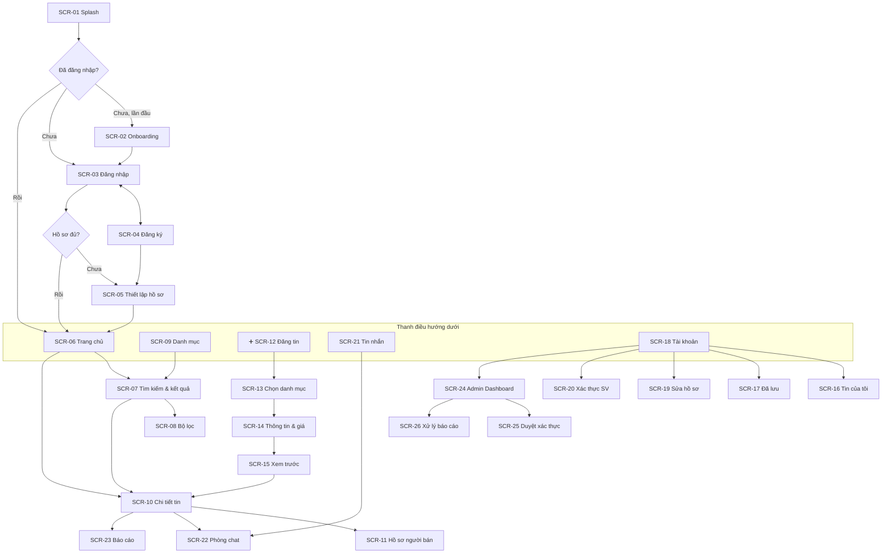

# 05 – Thiết kế giao diện

## 5.1. Nguyên tắc thiết kế

1. **Nhanh** – đăng tin theo từng bước, mỗi bước một việc; mặc định thông minh (khu vực = trường của tôi, Zalo = SĐT).
2. **Tin cậy** – luôn hiển thị huy hiệu xác thực, tình trạng chuẩn hoá, giá tham khảo.
3. **Gần gũi sinh viên** – ngôn ngữ thân thiện ("bạn"), màu tươi sáng.
4. **Nhất quán** – theo Material Design 3, dùng lại một bộ component.

## 5.2. Design system

### Màu sắc
| Token | Giá trị | Dùng cho |
|---|---|---|
| `primary` | `#2E7D32` (xanh lá) | Nút chính, thanh điều hướng đang chọn — gợi ý "tái sử dụng, bền vững" |
| `onPrimary` | `#FFFFFF` | Chữ trên nền primary |
| `primaryContainer` | `#C8E6C9` | Chip đang chọn, nền thẻ gợi ý giá |
| `secondary` | `#F57C00` (cam) | **Giá tiền**, nhãn "Nổi bật" |
| `surface` / `background` | `#FFFFFF` / `#F6F7F6` | Nền thẻ / nền màn hình |
| `onSurface` | `#1B1F1B` | Chữ chính |
| `onSurfaceVariant` | `#5F6B60` | Chữ phụ (khu vực, thời gian) |
| `error` | `#C62828` | Lỗi, nút báo cáo |
| `verified` | `#1E88E5` | Huy hiệu "SV đã xác thực" |

Màu nhãn tình trạng: Như mới `#2E7D32` · Tốt `#558B2F` · Khá `#F9A825` · Cũ `#8D6E63`.

### Chữ (Roboto hoặc Be Vietnam Pro – hỗ trợ tốt tiếng Việt)
| Kiểu | Cỡ / độ đậm | Dùng cho |
|---|---|---|
| Headline | 22sp / SemiBold | Tiêu đề màn hình |
| Title | 16sp / Medium | Tiêu đề tin trong chi tiết |
| Body | 14sp / Regular | Mô tả |
| Price-large | 22sp / Bold, màu `secondary` | Giá trong chi tiết |
| Price | 15sp / Bold, màu `secondary` | Giá trên thẻ |
| Caption | 12sp / Regular | Khu vực, thời gian, lượt xem |

### Khoảng cách & hình khối
- Lưới 8dp: lề màn hình 16dp, khoảng cách giữa thẻ 8–12dp.
- Bo góc: thẻ 12dp, nút 24dp (dạng viên thuốc), ảnh trong thẻ 8dp.
- Vùng chạm tối thiểu 48dp.

### Component dùng chung
| Component | Mô tả |
|---|---|
| `ListingCard` | Ảnh bìa tỷ lệ 1:1, nhãn tình trạng góc trên trái, nút ♡ góc trên phải, giá, tiêu đề (2 dòng), "Khu vực · 2 giờ trước" |
| `ConditionBadge` | Viên thuốc nhỏ, màu theo tình trạng |
| `VerifiedBadge` | Icon ✔ xanh + "SV đã xác thực" |
| `PriceText` | Định dạng `1.250.000đ`; giá 0 → "Tặng miễn phí" |
| `PriceSuggestionCard` | Thẻ nền `primaryContainer`: 💡 giá đề xuất, khoảng giá, số mẫu, nhãn độ tin cậy, nút "Dùng giá này" |
| `ScopeSwitcher` | Chip chọn: Trường tôi / Thành phố / Toàn quốc |
| `EmptyState` | Hình minh hoạ + câu thông báo + nút hành động |
| `StepIndicator` | "Bước 2/3" + thanh tiến trình |

## 5.3. Sơ đồ điều hướng



> Thanh điều hướng dưới có 5 mục: **Trang chủ · Danh mục · ➕ Đăng tin · Tin nhắn · Tài khoản**. "Đã lưu" nằm trong Tài khoản và có lối tắt ♡ trên thanh tiêu đề trang chủ. Mục "Admin" chỉ hiện với `role = admin`.

## 5.4. Danh sách màn hình

| Mã | Màn hình | UC | Ưu tiên |
|---|---|---|---|
| SCR-01 | Splash | – | M |
| SCR-02 | Onboarding (3 trang giới thiệu) | – | C |
| SCR-03 | Đăng nhập | UC-02, 03 | M |
| SCR-04 | Đăng ký | UC-01 | M |
| SCR-05 | Thiết lập hồ sơ (chọn trường) | UC-04 | M |
| SCR-06 | Trang chủ | UC-20, 27 | M |
| SCR-07 | Tìm kiếm & kết quả | UC-21, 22 | M |
| SCR-08 | Bộ lọc (bottom sheet) | UC-22 | M |
| SCR-09 | Danh mục | UC-23 | M |
| SCR-10 | Chi tiết tin | UC-24, 26, 30, 33 | M |
| SCR-11 | Hồ sơ người bán | UC-25 | S |
| SCR-12 | Đăng tin – Bước 1: Ảnh | UC-10 | M |
| SCR-13 | Đăng tin – Bước 2: Danh mục | UC-10 | M |
| SCR-14 | Đăng tin – Bước 3: Thông tin & giá | UC-10, 11 | M |
| SCR-15 | Đăng tin – Xem trước | UC-10 | M |
| SCR-16 | Tin của tôi | UC-14, 15, 16, 17, 18 | M |
| SCR-17 | Đã lưu | UC-26 | S |
| SCR-18 | Tài khoản | UC-06 | M |
| SCR-19 | Sửa hồ sơ | UC-04 | M |
| SCR-20 | Xác thực sinh viên | UC-05 | S |
| SCR-21 | Danh sách tin nhắn | UC-31 | S |
| SCR-22 | Phòng chat | UC-31 | S |
| SCR-23 | Báo cáo tin (bottom sheet) | UC-40 | S |
| SCR-24 | Admin – Dashboard | UC-54 | S |
| SCR-25 | Admin – Duyệt xác thực | UC-50 | S |
| SCR-26 | Admin – Xử lý báo cáo | UC-51, 52 | M |
| SCR-27 | Đẩy tin (mô phỏng thanh toán) | UC-17 | C |
| SCR-28 | Đánh giá người bán (dialog) | UC-32 | C |

## 5.5. Đặc tả & wireframe các màn hình chính

### SCR-05 – Thiết lập hồ sơ
```
┌──────────────────────────────┐
│  Hoàn tất hồ sơ        1/1   │
│                              │
│        ( 📷 Ảnh )            │
│  Họ và tên *                 │
│  [ Nguyễn Thị Lan          ] │
│  Trường *                    │
│  [ 🔍 Tìm trường...        ▾]│
│     Đại học Kinh tế Quốc dân │
│     Đại học Bách khoa Hà Nội │
│  Thành phố  (tự điền)        │
│  [ Hà Nội                  ] │
│  Số điện thoại *             │
│  [ 0912 345 678            ] │
│  Zalo  ☑ Giống số điện thoại │
│                              │
│  [        Bắt đầu         ]  │
└──────────────────────────────┘
```
- Danh sách trường có tìm kiếm không dấu ("bach khoa" → Bách khoa).
- Có lựa chọn "Không thấy trường của bạn?" → nhập tay.

### SCR-06 – Trang chủ
```
┌──────────────────────────────┐
│ UniMarket          ♡   🔔    │
│ [🔍 Bạn đang tìm gì?        ]│
│ (Trường tôi)(•Hà Nội)(Toàn quốc)│
│                              │
│  📚 Sách  💻 Điện tử  🏠 Đồ dùng│
│                              │
│ 🔥 Nổi bật               ›   │
│ ┌────┐ ┌────┐ ┌────┐         │  ← cuộn ngang
│ └────┘ └────┘ └────┘         │
│ 📖 Sách cho sinh viên NEU ›  │
│ ┌────┐ ┌────┐ ┌────┐         │  ← cuộn ngang
│ └────┘ └────┘ └────┘         │
│ 🆕 Tin mới                   │
│ ┌───────────┐ ┌───────────┐  │
│ │ [ảnh] Tốt♡│ │ [ảnh]  ♡  │  │
│ │ 45.000đ   │ │ 120.000đ  │  │
│ │ Giáo trình│ │ Quạt điện │  │
│ │ HN · 2 giờ│ │ HN · 5 giờ│  │
│ └───────────┘ └───────────┘  │  ← lưới 2 cột, cuộn vô hạn
├──────────────────────────────┤
│ 🏠    ▦     (➕)    💬    👤  │
└──────────────────────────────┘
```
| Trạng thái | Hiển thị |
|---|---|
| Đang tải | Khung xương (skeleton) cho thẻ |
| Rỗng (thành phố chưa có tin) | "Chưa có tin nào ở Hà Nội. Hãy là người đầu tiên!" + [Đăng tin] + [Xem toàn quốc] |
| Lỗi | "Không tải được dữ liệu" + [Thử lại] |
| Khách | Ẩn mục "Sách cho trường bạn", ScopeSwitcher mặc định Toàn quốc |

### SCR-07 & SCR-08 – Kết quả tìm kiếm & bộ lọc
```
┌──────────────────────────────┐       ┌──────────────────────────────┐
│ ←  [ kinh te vi mo        ✕ ]│       │ Bộ lọc                  Xoá  │
│ (•Hà Nội ▾) (Bộ lọc • 2) (Mới nhất ▾)│ │ Danh mục                     │
│ 23 kết quả                   │       │ [Sách ▾] [Giáo trình ▾]      │
│ ┌───────────┐ ┌───────────┐  │       │ Khoảng giá                   │
│ │           │ │           │  │       │ [ 0 ]  —  [ 100.000 ]        │
│ └───────────┘ └───────────┘  │       │ ●━━━━━━━━━━━━○                │
│ ┌───────────┐ ┌───────────┐  │       │ Tình trạng                   │
│ │           │ │           │  │       │ [Như mới][•Tốt][•Khá][Cũ]    │
│ └───────────┘ └───────────┘  │       │ ☑ Chỉ người bán đã xác thực  │
│                              │       │ ☐ Có thể ship                │
│                              │       │ [   Xem 23 kết quả   ]       │
└──────────────────────────────┘       └──────────────────────────────┘
```
- Khi chưa nhập gì: hiện "Tìm kiếm gần đây" và "Gợi ý: giáo trình, quạt, casio, laptop".
- Rỗng: "Không tìm thấy kết quả cho 'xyz'" + [Mở rộng ra Toàn quốc] [Xoá bộ lọc].

### SCR-10 – Chi tiết tin
```
┌──────────────────────────────┐
│ ←                  ⤴  ♡  ⋮   │
│ ┌──────────────────────────┐ │
│ │        [ ẢNH 1/4 ]       │ │  ← vuốt ngang, chạm để phóng to
│ └──────────────────────────┘ │
│ 45.000đ                      │
│ Giáo trình Kinh tế vi mô     │
│ (Tốt)  📍 ĐH KTQD, Hà Nội    │
│ 🕑 2 giờ trước · 👁 36 lượt xem│
│ ──────────────────────────── │
│ 💡 Giá thị trường: 43k – 47k │
│ ──────────────────────────── │
│ Thông tin chi tiết           │
│ Môn học   Kinh tế vi mô      │
│ NXB       ĐH KTQD, 2022      │
│ Giá bìa   80.000đ            │
│ Mô tả                        │
│ Sách còn mới, có ghi chú bút │
│ chì vài trang…   Xem thêm    │
│ ──────────────────────────── │
│ (👤) Nguyễn Thị Lan  ✔SV     │
│      NEU · ⭐ 4,8 (5) · 12 tin  › │
│ ──────────────────────────── │
│ Tin tương tự                 │
│ ┌────┐ ┌────┐ ┌────┐         │
├──────────────────────────────┤
│ [📞 Gọi] [Zalo] [💬 Chat   ] │  ← thanh cố định dưới
└──────────────────────────────┘
```
- Khách bấm Gọi/Zalo/Chat → yêu cầu đăng nhập.
- Chủ tin xem tin của chính mình: thanh dưới đổi thành [Sửa] [Đã bán] [⋮ Đẩy tin / Ẩn / Xoá].
- Tin đã bán: dải xám "Tin này đã bán" trên ảnh, ẩn nút liên hệ.
- Menu ⋮: Báo cáo, Chia sẻ.

### SCR-12 → SCR-15 – Đăng tin (3 bước + xem trước)
```
Bước 1/3 – Ảnh                    Bước 2/3 – Danh mục
┌──────────────────────────────┐  ┌──────────────────────────────┐
│ ✕  Đăng tin          1/3     │  │ ←  Đăng tin          2/3     │
│ ▓▓▓▓▓░░░░░░░░░░              │  │ ▓▓▓▓▓▓▓▓▓▓░░░░░              │
│ Thêm ảnh (tối đa 6)          │  │ Món đồ thuộc loại nào?       │
│ ┌────┐ ┌────┐ ┌────┐         │  │ 📚 Sách                    › │
│ │BÌA │ │ ✕  │ │ ＋ │         │  │ 💻 Đồ điện tử              › │
│ └────┘ └────┘ └────┘         │  │ 🏠 Đồ dùng                 › │
│ 💡 Ảnh rõ, đủ sáng giúp bán  │  │                              │
│    nhanh hơn 2 lần           │  │ (chọn cha → hiện danh sách   │
│ Giữ & kéo để đổi thứ tự      │  │  danh mục con)               │
│                              │  │                              │
│ [          Tiếp          ]   │  │                              │
└──────────────────────────────┘  └──────────────────────────────┘

Bước 3/3 – Thông tin & giá ⭐
┌──────────────────────────────┐
│ ←  Đăng tin          3/3     │
│ ▓▓▓▓▓▓▓▓▓▓▓▓▓▓▓              │
│ Tiêu đề *                    │
│ [ Giáo trình Kinh tế vi mô ] │
│ Tình trạng *                 │
│ (Như mới)(•Tốt)(Khá)(Cũ)  ⓘ  │
│ Môn học *   [ Kinh tế vi mô ]│
│ Giá bìa     [ 80.000       ] │
│ ┌──────────────────────────┐ │
│ │💡 Gợi ý giá   ● Trung bình│ │
│ │   43.000đ                 │ │
│ │   Khoảng: 43.000 – 47.000đ│ │
│ │   Dựa trên 6 tin tương tự │ │
│ │   ở Hà Nội (4 đã bán)     │ │
│ │          [ Dùng giá này ] │ │
│ └──────────────────────────┘ │
│ Giá bán *   [ 43.000     ] đ │
│ ☐ Tặng miễn phí              │
│ Mô tả *                      │
│ [                          ] │
│ Nơi giao dịch                │
│ [ ĐH KTQD, Hà Nội        ▾ ] │
│ ☐ Có thể ship                │
│ [        Xem trước       ]   │
└──────────────────────────────┘
```
- ⓘ cạnh Tình trạng mở bảng giải thích 4 mức (bảng ở 03, mục 3.7).
- Trường riêng thay đổi theo danh mục con (vd. Laptop: Hãng*, Model*, CPU, RAM, Năm mua, Giá mua gốc).
- Biến thể thẻ gợi ý:
  - Độ tin cậy **Cao/TB/Thấp** → chấm màu xanh/vàng/cam.
  - **Ước tính**: "Ước tính theo khấu hao từ giá gốc 15.000.000đ (mua 2024)".
  - **Không đủ dữ liệu**: "Chưa đủ dữ liệu để gợi ý. Nhập giá gốc/giá bìa để nhận ước tính."
- Giá lệch > 50% so với gợi ý: dòng cảnh báo vàng dưới ô giá, không chặn.
- **SCR-15 Xem trước**: hiển thị y như SCR-10 với nhãn "Xem trước", hai nút [Sửa lại] [Đăng tin].

### SCR-16 – Tin của tôi
```
┌──────────────────────────────┐
│ ←  Tin của tôi               │
│ Đang bán(5) Giao dịch(1) Đã bán(8) Hết hạn(2) Bị ẩn(0) │  ← tab cuộn ngang
│ ┌──────────────────────────┐ │
│ │[ảnh] Giáo trình KT vi mô │ │
│ │      45.000đ   👁 36 ♡ 4  │ │
│ │      Còn 27 ngày          │ │
│ │ [Sửa] [Đã bán] [Đẩy] [⋮] │ │
│ └──────────────────────────┘ │
│ ┌──────────────────────────┐ │
│ │[ảnh] Quạt Senko          │ │
│ │ ...                       │ │
└──────────────────────────────┘
```
- Tab Hết hạn: nút [Gia hạn] (ẩn khi đã gia hạn 2 lần).
- Tab Bị ẩn: hiển thị lý do ("Đang chờ xem xét do bị báo cáo").
- Dialog **Đã bán**: ô "Giá bán thực tế" (mặc định = giá rao), danh sách "Bạn bán cho ai?" (người đã chat) + "Người khác/không nhớ".

### SCR-20 – Xác thực sinh viên
- Hai tab: **Email trường** (nhập email → gửi link) | **Ảnh thẻ SV** (chụp ảnh, nhập MSSV, gửi).
- Hiển thị trạng thái hiện tại: Chưa xác thực / Đang chờ duyệt / Đã xác thực ✔ / Bị từ chối (lý do + thời điểm gửi lại được).
- Dòng cam kết: "Ảnh thẻ chỉ dùng để xác thực và sẽ bị xoá sau khi duyệt."

### SCR-22 – Phòng chat
```
┌──────────────────────────────┐
│ ←  (👤) Nguyễn Thị Lan  ✔    │
│ ┌──────────────────────────┐ │
│ │[ảnh] Giáo trình KT vi mô │ │  ← thẻ tin đăng, chạm để mở
│ │      45.000đ             │ │
│ └──────────────────────────┘ │
│            Món này còn không bạn? ▌│
│ ▌Còn bạn ơi                   │
│            Bớt 40k được không? ▌│
│                              │
│ (Còn không?)(Bớt được không?)(Hẹn ở đâu?)│
│ [ Nhập tin nhắn...      ] ➤  │
└──────────────────────────────┘
```

### SCR-24 – Admin Dashboard
```
┌──────────────────────────────┐
│ ←  Quản trị    [7 ngày ▾]    │
│ ┌────────┐ ┌────────┐        │
│ │ 12     │ │ 48     │        │
│ │Giao dịch│ │Người dùng│      │
│ │thành công│ │hoạt động │     │
│ └────────┘ └────────┘        │
│ ┌────────┐ ┌────────┐        │
│ │ 18%    │ │ 4,2 ngày│       │
│ │Tỷ lệ bán│ │TG bán TB│       │
│ └────────┘ └────────┘        │
│ ┌────────┐ ┌────────┐        │
│ │ 46%    │ │ 60.000đ│        │
│ │Dùng giá│ │Doanh thu│       │
│ │ gợi ý  │ │ mô phỏng│       │
│ └────────┘ └────────┘        │
│ Tin đăng / tin bán theo ngày │
│ [ biểu đồ cột ]              │
│ Phân bổ theo danh mục        │
│ [ biểu đồ thanh ngang ]      │
│ ──────────────────────────── │
│ ⚠ Báo cáo chờ xử lý (3)    › │
│ 🪪 Xác thực chờ duyệt (5)  › │
└──────────────────────────────┘
```

## 5.6. Nội dung chữ (microcopy) chính

| Ngữ cảnh | Nội dung |
|---|---|
| Đăng tin thành công | "Đăng tin thành công! 🎉 Chia sẻ để bán nhanh hơn." |
| Vượt giới hạn tin | "Bạn đang có 20 tin đang bán. Hãy đánh dấu 'Đã bán' hoặc xoá bớt tin cũ để đăng tin mới." |
| Chứa từ khoá cấm | "Tin của bạn có nội dung không được phép đăng: '…'. Vui lòng chỉnh sửa." |
| Yêu cầu đăng nhập | "Đăng nhập để liên hệ người bán nhé!" |
| Đã lưu tin | "Đã lưu vào mục Yêu thích" |
| Báo cáo thành công | "Cảm ơn bạn đã báo cáo. Chúng mình sẽ xem xét sớm nhất." |
| Tin sắp hết hạn | "Tin 'Quạt Senko' sẽ hết hạn sau 3 ngày. Gia hạn ngay?" |
| An toàn giao dịch (chi tiết tin) | "💡 Nên gặp trực tiếp ở nơi công cộng trong trường, kiểm tra hàng trước khi trả tiền." |
| Xoá tin | "Xoá tin này? Bạn không thể khôi phục lại." [Huỷ] [Xoá] |

## 5.7. Gợi ý quy trình thiết kế
1. Vẽ **wireframe** độ trung thực thấp (giấy hoặc Figma) cho SCR-06, 07, 10, 12–15, 16.
2. Kiểm tra nhanh với 3–5 bạn: giao nhiệm vụ "đăng bán một cuốn sách", quan sát chỗ vướng.
3. Làm **mockup** Figma độ trung thực cao theo design system ở 5.2.
4. Ghép thành **prototype** bấm được để đưa vào báo cáo và slide bảo vệ.
